# From Git to Gold: Data Engineering Assignment

**Student:** Devansh Singh

**Roll number:** 23BCS074

## Part A: Git and CI/CD

### A1. Repository

Repository: `https://github.com/DevanshXerc90/freshcart-pipelines`. The repository contains the ELT, Mage, and RabbitMQ implementations, tests, CI workflow, and instructor reference notebooks. `reference/Maze_ML_PipeLine.ipynb` is unchanged. In `reference/freshcart_elt_simple.ipynb`, the source and other cells are preserved; only cell 4's saved output was cleared and its execution count reset to remove a credential-like value. The history rewrite removes this notebook path from the rewritten local refs, but cannot remove copies in forks, clones, or GitHub caches.

### A2. Git command table

| Command | Where the change happens | What it does |
| --- | --- | --- |
| `git init` | Local `.git` repository | Starts version tracking. |
| `git add train.py` | Staging area | Selects the current file content for the next snapshot. |
| `git commit -m "msg"` | Local repository | Records staged content locally; it does not update GitHub. |
| `git remote add origin URL` | Local Git configuration | Saves a remote name and URL. |
| `git push -u origin main` | Remote repository | Uploads local commits and sets the upstream branch. |
| `git pull origin main` | Working folder/local repository | Fetches and integrates commits from the remote branch. |

A teammate cannot see a local commit on GitHub until it is pushed and they have repository access.

### A3. CI and split test

`tests/test_prepare_data.py` checks an 80/20 split (120 train and 30 test samples). A 70/30 change produced a failing test (105 train samples); restoring 80/20 passed. GitHub Actions run 1 passed, run 2 failed on the intentional split change, and run 3 passed after correction. The local run evidence is in the repository tests; CI screenshots are in the appendix.

## Part B: FreshCart ELT

### B1. Baseline

The actual baseline run against `FRESHCART_B1` used run ID `20261115_063011_352098`.

| Measure | Actual baseline |
| --- | ---: |
| Bronze raw order rows | 8 (6 web, 2 mobile) |
| Clean rows | 6 |
| Quarantined rows | 2 |
| Deduplicated rows | 4 |
| Gold orders | 4 |
| Gold revenue | INR 7,785.00 |
| Gold loyalty points | 126 |
| Rejected share | 25% |

The six baseline quality checks returned `OK`, and the output reported the values above. Full evidence: `b1_baseline_results.md`.

### B2. Record trace

The web source uses flat keys (`order_id`, `cust_email`, `amount`, `updated_at`); mobile uses nested/different keys (`orderId`, `customer.email`, `total.value`, `updatedAt`). `SQL_10_ORDERS_CLEAN` maps both to unified columns, normalizes fields, parses values, and records validation reasons. For ORD-1003, the mobile value `2,100.00` was parsed as INR 2,100.00. Its later timestamp (18:40 vs. 09:10) wins the `ROW_NUMBER()` ordering by `updated_at DESC, ingest_seq DESC`. Gold records INR 2,100 and 63 points: `FLOOR(2100/100) × 3`.

For Priya, the SCD2 date join places ORD-1001 on Sept. 1 in Silver (12 points) and ORD-1005 on Sept. 3 in Gold (16 points). Full source rows, queries, and calculations: `b2_record_trace.md`.

#### Captured source records and transformation

The read-only trace in `reports/b2_record_trace.md` recorded two raw ORD-1003 records under B1 run ID `20261115_063011_352098`. Representative actual JSON (whitespace normalized from the saved rows):

```json
{"order_id":"ORD-1003","cust_email":"meera@outlook.com","cust_name":"MEERA S","order_date":"2026-09-02","amount":null,"currency":"INR","pincode":"400050","updated_at":"2026-09-02 09:10:00"}
{"orderId":"ORD-1003","customer":{"email":"Meera@Outlook.com","name":"Meera S"},"orderDate":"02/09/2026","total":{"value":"2,100.00","currency":"INR"},"deliveryPin":"400050","updatedAt":"2026-09-02T18:40:00"}
```

The web mapping is `order_id→order_id`, `cust_email→email`, `cust_name→name`, `order_date→order_date`, `amount→amount`, `currency→currency`, `pincode→pincode`, and `updated_at→updated_at`. The mobile mapping is `orderId→order_id`, `customer.email→email`, `customer.name→name`, `orderDate→order_date`, `total.value→amount`, `total.currency→currency`, `deliveryPin→pincode`, and `updatedAt→updated_at`; the common cleaning step trims values, lowercases email, normalizes currency, and parses dates/timestamps. The amount expression is `TRY_TO_DECIMAL(REGEXP_REPLACE(amount, '[^0-9.-]', ''), 12, 2)`, which converts the recorded mobile string `2,100.00` to `2100.00` while the web amount remains NULL.

The checked-row query and the dedup SQL are preserved in `reports/b2_record_trace.md`. The dedup expression is:

```sql
QUALIFY ROW_NUMBER() OVER (
  PARTITION BY order_id ORDER BY updated_at DESC, ingest_seq DESC
) = 1
```

For ORD-1003 the mobile record at 18:40 (ingest sequence 8) therefore survives over the web record at 09:10 (sequence 2). The actual trace found ORD-1001 on Priya's Silver SCD2 interval (INR 1,250; `FLOOR(1250/100)×1=12` points) and ORD-1005 on her Gold interval (INR 899; `FLOOR(899/100)×2=16` points). The saved report contains the queried rows and Gold outputs; these are captured B1 evidence, not a rerun.

### B3. Currency validation

The cleaning SQL normalizes currency with `UPPER(TRIM(currency))` and adds `unsupported_currency` when currency is NULL or outside `INR`/`USD`:

```sql
IFF(currency IS NULL OR currency NOT IN ('INR', 'USD'), 'unsupported_currency', NULL)
```

For ORD-1006 (`EUR`, email `vikram@@mail`, pincode `99999`), the **actual observed** reasons were `["bad_email", "bad_pincode", "unsupported_currency"]`. A later read-only SELECT on the existing checked row, omitting only the currency predicate, produced the **counterfactual** `["bad_email", "bad_pincode"]`. The malformed email and invalid pincode still make the reasons array non-empty, while `silver.orders_clean` accepts only rows where `ARRAY_SIZE(reasons) = 0`; therefore ORD-1006 stays out of clean/deduplicated Silver and Gold either way. Gold at the B3 investigation was 4 orders, INR 7,785.00 revenue, and 126 points. Those are actual observed totals; the no-currency result is a counterfactual explanation, not a second Gold execution.

The quarantine insert's `NOT EXISTS` matches `source`, null-safe `order_id`, and `updated_at` from the stored `row_data`. It skips the same rejected source/order version on a later execution; the `QUALIFY ROW_NUMBER()` also limits duplicates within the current batch. The inspected table held 2 quarantine rows, including one ORD-1006 record. The rerun behavior follows from SQL inspection; no reapplication was performed.

Git history first records the rule in commit `8eccbba` (`2026-11-15T01:36:32+05:30`); its parent does not contain the pipeline file. B1 run `20261115_063011_352098` records extraction at `2026-11-15T06:30:11.356583Z`, about 10 hours 24 minutes later. The evidence-summary files were committed later in checkpoint `8ccf28c` (`2026-11-15T12:45:57+05:30`). The rule was present before the recorded baseline. No genuine pre-rule Snowflake output, run ID, or execution log was found; the SELECT-based counterfactual is not historical before-and-after evidence. See `reports/b3_currency_validation.md` for the timeline and evidence limits.

### B4. Arjun SCD2 update

The approved CRM event made CUST-02 Gold effective 2026-08-15. Actual SCD2 history contains the Silver period through 2026-08-14 and the Gold period from 2026-08-15. ORD-1002 (Sept. 1) changed from Silver to Gold; its points changed 35 to 70. Exactly one Gold row's hash and `published_at` changed. Gold totals moved from 4 orders / INR 7,785.00 / 126 points to 4 / INR 7,785.00 / 161 points. Only the one CRM event and targeted SCD2/Gold SQL were run; the pipeline and other source loads were not rerun. Actual results: `b4_actual_results.md`; prior prediction: `b4_predictions.md`.

#### Prediction compared with recorded actual

| Measure | Pre-run prediction | Recorded actual |
|---|---:|---:|
| CUST-02 SCD2 rows | 2 | 2 |
| ORD-1002 tier | Gold | Gold |
| ORD-1002 points | 70 | 70 |
| Gold loyalty points | 161 | 161 |
| Rows with changed `published_at` | 1 | 1 (ORD-1002) |

The evidence is in `reports/b4_predictions.md` and `reports/b4_actual_results.md`; actual targeted CRM run ID `20261115_070420_455684`. `SQL_40_GOLD` calculates a `row_hash` over the business attributes and derived values used in the Gold row, then MERGEs on `order_id`. A matched row is updated (including `published_at`) only when `t.row_hash <> s.row_hash`; a matched unchanged hash does not trigger an update, while a new order is inserted. In this run only ORD-1002 changed hash as its tier multiplier and points changed; other Gold rows kept their prior hashes and timestamps.

Bronze is an append-only landing layer: each ingestion run writes run-ID-specific raw files and `COPY INTO` appends their records to Bronze rather than replacing earlier raw records. Thus repeated ingestion runs increase Bronze history even where later Silver deduplication and Gold MERGE produce the same business rows.

### B5. Future-date quality check

The actual controlled test confirmed the temporary ID was absent and the starting future-date count was 0. A single transaction inserted only `ORDER_ID` and `ORDER_DATE` for `B5-MOCK-FUTURE-001` dated 2099-01-01. The targeted quality check produced `future-dated silver orders 1 PROBLEM`. The row was deleted by that ID; its count returned to 0, the future-date count returned to 0, and the original Silver row count (4) and Gold totals (4 orders, INR 7,785.00, 161 points) were verified before commit. Post-commit read-only verification confirmed the same. `run_pipeline()` and the full quality-check function during insertion were not used. See `b5_quality_check.md` and raw `b5_quality_check_execution.log`.

**ETL and ELT:** In ETL, data is transformed before it is loaded into the target, while ELT loads source data first and applies transformations in the destination platform. ELT suits this project because the raw Bronze records remain available for repeatable warehouse transformations and audit. ETL would be preferable where policy requires sensitive fields to be filtered or masked before they reach the destination, or where the target cannot safely store raw source data. This distinction describes the design choice; the B5 evidence itself is the targeted quality-check transaction recorded above.

## Part C: Mage Iris ML pipeline

### C1. Pipeline and execution

The existing graph is `load_iris → validate_iris → prepare_data → train_model`, with `train_model` branching to `save_results` and `evaluate_model`. Conditional decorator imports preserve Mage-injected decorators while allowing standalone imports when Mage is absent. The dedicated actual C1 execution log is `c1_mage_run.log`: exit code 0, six block tests passed, and Mage reported `Pipeline run completed.`

#### Block inventory and test purpose

The table follows the existing `iris_project/pipelines/iris_classifier/metadata.yaml` graph and block source files. C1's actual log records six passing block tests; the table's purpose descriptions come from the respective `@test` functions.

| Block | Mage type | Test purpose |
|---|---|---|
| `load_iris` | `data_loader` | Verify 150 rows and presence of `target`. |
| `validate_iris` | `transformer` | Verify no missing values and exactly three target classes. |
| `prepare_data` | `transformer` | Verify 120 training and 30 test rows. |
| `train_model` | `transformer` | Require held-out accuracy of at least 0.8. |
| `save_results` | `data_exporter` | Verify prediction column and 30 exported rows. |
| `evaluate_model` | `transformer` | Verify metric names/range and valid 3×3 confusion-matrix CSV. |

### C2. Max-depth experiments

All five were actual sequential `mage run` executions in `mageai/mageai:latest`, each with `--runtime-vars`; `iris_predictions.csv` was deleted before every run. The successful-run accuracy comes from each run's CSV (30 rows); depth 1 accuracy is from Mage's failed test message.

| `max_depth` | Actual accuracy | `train_model` test | CSV created |
|---:|---:|---|---|
| 1 | 0.633 | FAIL (expected, below 0.8) | No |
| 2 | 0.966667 (29/30) | PASS | Yes |
| 3 | 1.000 (30/30) | PASS | Yes |
| 4 | 1.000 (30/30) | PASS | Yes |
| 5 | 1.000 (30/30) | PASS | Yes |

When depth 1 fails the `train_model` test, Mage stops downstream execution, so `save_results` does not create the CSV. Logs: `c2_depth_1.log` through `c2_depth_5.log`; summary: `c2_depth_experiments.md`.

#### Why the test is a gate

Mage runs the `train_model` test on the block output before scheduling downstream blocks. At depth 1 its measured accuracy was 0.633, below the unchanged 0.8 threshold, so the block failed and `save_results` did not run; this matches the absent CSV in the actual depth-1 log. Testing before saving enforces the quality condition before publishing an artifact, avoiding downstream consumers treating a known-failing model output as valid and avoiding a later cleanup/check step. The per-depth logs are `reports/c2_depth_1.log` through `reports/c2_depth_5.log`; the output table above records the actual results.

### C3. Evaluation branch and confusion matrix

Metadata has exactly one `evaluate_model`; `train_model` has exactly two downstream blocks: `save_results` and `evaluate_model`. At depth 3 the actual Mage run completed with all six block tests passing. With rows = actual and columns = predicted, labels `[0,1,2]`, the matrix was:

| Actual \\ Predicted | 0 | 1 | 2 |
|---:|---:|---:|---:|
| 0 | 10 | 0 | 0 |
| 1 | 0 | 9 | 0 |
| 2 | 0 | 0 | 11 |

| Metric | Actual value |
|---|---:|
| Accuracy | 1.0 |
| Precision (macro average) | 1.0 |
| Recall (macro average) | 1.0 |
| F1 score (macro average) | 1.0 |

The matrix was saved as `reports/c3_confusion_matrix.csv`. Complete run output and metadata are in `c3_evaluation.md` and `c3_mage_run.log`.

#### Actual pipeline branch configuration

The following is the actual branch segment in `iris_project/pipelines/iris_classifier/metadata.yaml`; the full file has one `evaluate_model` entry and no duplicate:

```yaml
- name: train_model
  uuid: train_model
  type: transformer
  language: python
  upstream_blocks: [prepare_data]
  downstream_blocks: [save_results, evaluate_model]
- name: save_results
  uuid: save_results
  type: data_exporter
  language: python
  upstream_blocks: [train_model]
  downstream_blocks: []
- name: evaluate_model
  uuid: evaluate_model
  type: transformer
  language: python
  upstream_blocks: [train_model]
  downstream_blocks: []
```

This is the existing graph used by the actual C3 run; the complete captured metadata and execution record are in `reports/c3_evaluation.md` and `reports/c3_mage_run.log`.

### C4. Validation block

`validate_iris` is a transformer directly after `load_iris`; it rejects missing values and any target count other than exactly three classes, returns the original dataframe unchanged, and owns a `@test` checking both conditions. It is connected to `prepare_data` in metadata and is not duplicated. The actual Mage pipeline completed with six block tests passing. Evidence: `c4_custom_block.md` and `c4_mage_run.log`.

## Part D: RabbitMQ stream

### D1. Predicted and actual routing

The original predictions were preserved. `*` matches exactly one word; `#` matches zero or more words. For the two-word key `bangalore.koramangala`, `bangalore.#` matches with zero following words; the other bindings require three words.

| Routing key | Predicted recipients | Actual recipients | Result |
|---|---|---|---|
| `bangalore.koramangala.food` | Ravi, Meena, Control | Ravi, Meena, Control | Routed |
| `bangalore.indiranagar.ride` | Priya, Arjun, Control | Priya, Arjun, Control | Routed |
| `bangalore.whitefield.ride` | Arjun, Control | Arjun, Control | Routed |
| `chennai.tnagar.food` | Karthik | Karthik | Routed |
| `chennai.whitefield.ride` | Dropped | No driver | Dropped as unroutable |
| `bangalore.koramangala` | Control only | Control | Routed |

Unique IDs D1-01 through D1-06 are in publisher/driver logs. The fifth was publisher-confirmed but mandatory return handling identified it as unroutable; confirmation alone did not indicate a consumer delivery. No prediction mismatch occurred. See `d1_routing_predictions.md` and `d1_routing_results.md`.

### D2. Two-minute dispatcher test

The actual run lasted 120.097 seconds (01:36:50.9758712 to 01:38:51.0731853, +05:30). All six drivers reported listening first. The dispatcher logged 59 unique publishes: 54 valid payloads and 5 without `zone` (sequences 10, 20, 30, 40, 50).

| Driver | Valid received | Invalid rejected |
|---|---:|---:|
| Ravi | 5 | 1 |
| Priya | 9 | 2 |
| Arjun | 10 | 2 |
| Meena | 14 | 1 |
| Karthik | 8 | 1 |
| Control | 24 | 3 |
| **Deliveries** | **70** | **10** |

One publish can reach multiple queues through topic bindings, so delivery totals are not expected to equal publish count. One invalid publication matched no configured driver. Raw logs and samples are identified in `d2_rabbitmq_results.md`.

#### Actual D1 publisher/driver excerpt for predicted routing

The following short excerpt is from the separate deterministic D1 live routing evidence (`reports/rabbitmq_logs/d1/publisher.log` and the named driver logs). It illustrates the predicted recipient set; it is not part of the D2 two-minute count. For the predicted route `bangalore.indiranagar.ride → Priya, Arjun, Control`, the publisher recorded:

```text
id=D1-02 routing_key=bangalore.indiranagar.ride publisher_confirmation=received route_status=routed
```

The actual consumer logs recorded the same message ID on each expected queue:

```text
[Priya] RECEIVED routing_key=bangalore.indiranagar.ride message_id=D1-02 status=received
[Arjun] RECEIVED routing_key=bangalore.indiranagar.ride message_id=D1-02 status=received
[Control] RECEIVED routing_key=bangalore.indiranagar.ride message_id=D1-02 status=received
```

These actual log lines agree with the preserved D1 prediction. The D2 totals above remain independently derived from the D2 dispatcher and driver logs.

### D3. ACK and NACK

The 60.392-second run published 29 unique messages: 27 valid and 2 missing `zone`. Actual driver logs recorded 45 ACKs and 3 `NACK(requeue=False)` operations. One invalid message matched Ravi, Meena, and Control and was NACKed once by each queue; the other matched no configured queue. No invalid ID was processed more than once by the same driver. Valid traffic continued. A consumer closing before ACK causes RabbitMQ to requeue an unacknowledged delivery for redelivery. Permanently invalid messages with `requeue=True` can loop; `requeue=False` prevents re-delivery to that queue (with no DLX configured here, RabbitMQ discards it). Evidence and raw-log location: `d3_ack_nack.md`.

## Part E: Integration architecture and reflection

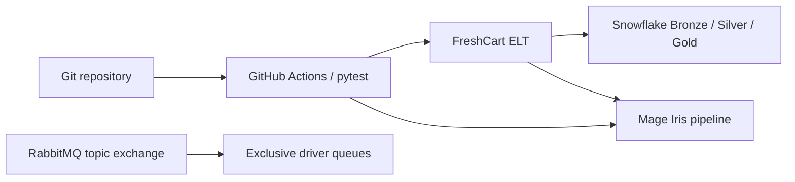

### Personal reflection

One of the main issues I encountered during this assignment occurred while running the Iris ML pipeline using Mage inside Docker. The initial execution failed with the error: Block load_iris does not have any decorated functions. Although Docker was running correctly and the required Python libraries were available, Mage could not recognise the data loader function.

I investigated the block implementation and discovered that the files were directly importing decorators such as @data_loader, @transformer and @test from Mage. These imports were replacing the decorators provided by Mage during block execution. To fix this, I updated all six Mage block files to import decorators only when they were not already available in the execution environment. I also retained fallback decorators so that the blocks could still be tested outside Mage.

After making this correction, I ran the complete test suite inside the Mage Docker container, which passed all 18 tests. I then executed the complete Mage pipeline successfully, with all six block tests passing.

This experience taught me the importance of understanding how an orchestration framework executes individual blocks, rather than assuming that every execution failure is caused by the underlying application logic. It also showed me the value of investigating error messages, making a targeted correction and verifying the solution through both automated tests and an actual pipeline run.

## Optional bonus: RabbitMQ to FreshCart ELT (live verified)

The live test used the ownership-marked `FRESHCART_BONUS` database only. One publisher invocation confirmed exactly two messages. The consumer collected for **60.001 seconds**, wrote and loaded the first unique web landing file, ACKed both records after the landing write, loaded supporting fixtures, and completed the existing transformations. One replay loaded the exact first file's same two business payloads into a distinct physical landing file with a new run ID; no RabbitMQ messages were republished.

| Metric | First pass | After replay |
|---|---:|---:|
| Bronze order rows | 2 | 4 |
| Silver deduplicated orders | 2 | 2 |
| Gold orders | 2 | 2 |
| Gold revenue | INR 5,092.38 | INR 5,092.38 |
| Gold loyalty points | 50 | 50 |
| Duplicate Gold order IDs | 0 | 0 |

Each order appeared exactly once in Gold: `BONUS-ORDER-001` had INR 1,550.00 and 15 points; `BONUS-ORDER-002` had INR 3,542.38 and 35 points. The run created five physical landing files: first-pass web, CRM, FX, and pincode files, plus the replay web file. Supporting raw fixture counts were four CRM rows, one FX row containing three rates, and three pincode rows (eight fixture rows total).

Bronze grew because replay loaded the same business payloads from a second physical landing file, appending another raw row for each order. Existing Silver deduplication retained two business orders, and the Gold MERGE preserved their totals without duplicate IDs. This verifies idempotency for these two approved orders and one replay. Raw logs, SQL snapshots, run summaries, payload comparison, and timestamps are in `reports/bonus/live_5f057039be864ea497eaa9496e2810bd/`; the architecture and evidence index are in `reports/bonus/bonus_architecture.md`.

Publisher and replay exit codes were 0. The consumer process terminated and its complete log records successful processing stages and final results, but its launcher did not capture the operating-system exit code; no numeric consumer exit code is claimed.

## Git commit history

```text
8caa0bf Include corrective green Actions evidence
4c2a3e7 Document actual CI runs and screenshots
4c4052e Fix Iris split back to 80/20
a643bc8 Demonstrate failing 70/30 split test
d3292be Refresh report with final local history
2d4cf49 Add explicit notebook cell language metadata
9646bc3 Record milestone history in assignment report
5c2758a Test all Iris accuracy gate depths
4224f95 Add evidence-aware assignment report draft
d79f24f Add instructor reference notebooks unchanged
c50567b Implement RabbitMQ topic stream handlers
8eccbba Implement credential-safe FreshCart ELT flow
3717bac Implement Mage Iris pipeline blocks
cd7cc42 Add Part A CI and prepare-data test
```

The path-history cleanup rewrote local `main`; the list above shows its 14 commits before the final submission commit.

## Appendix: screenshot evidence

### GitHub Actions

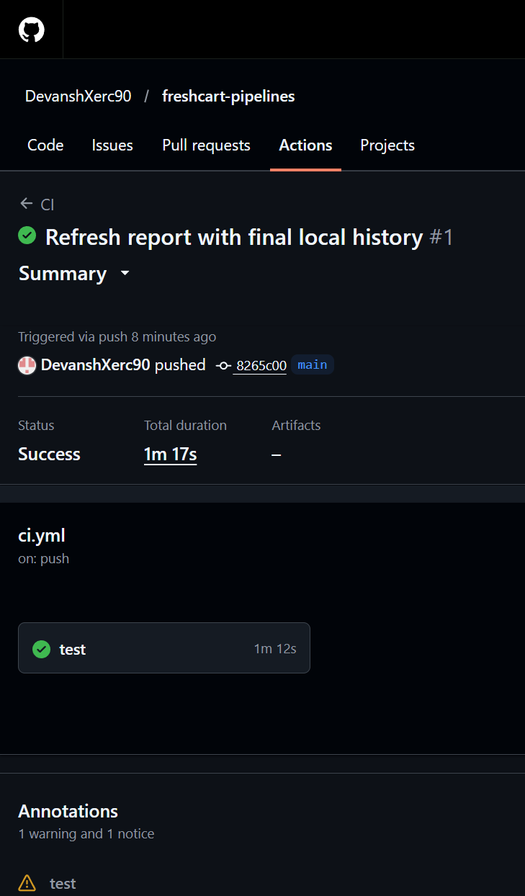

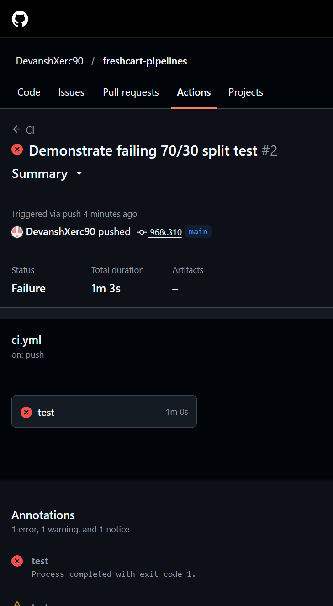

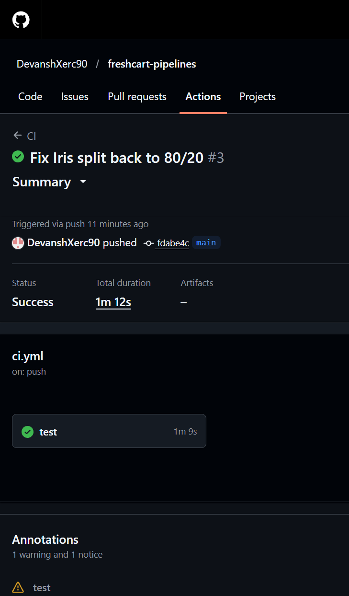

### Mage pipeline

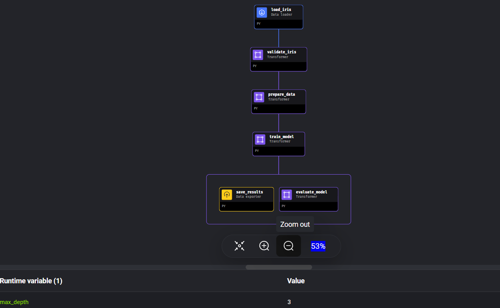

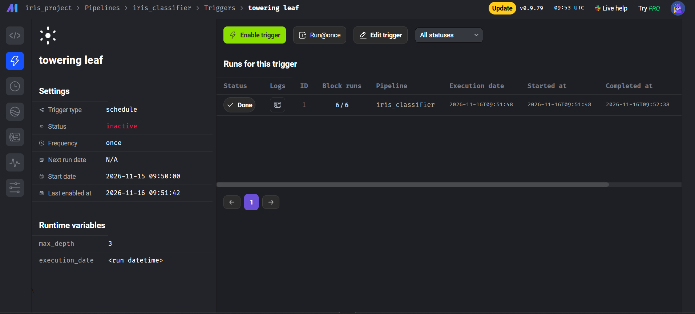

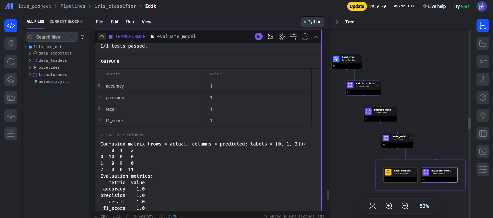

### RabbitMQ management UI

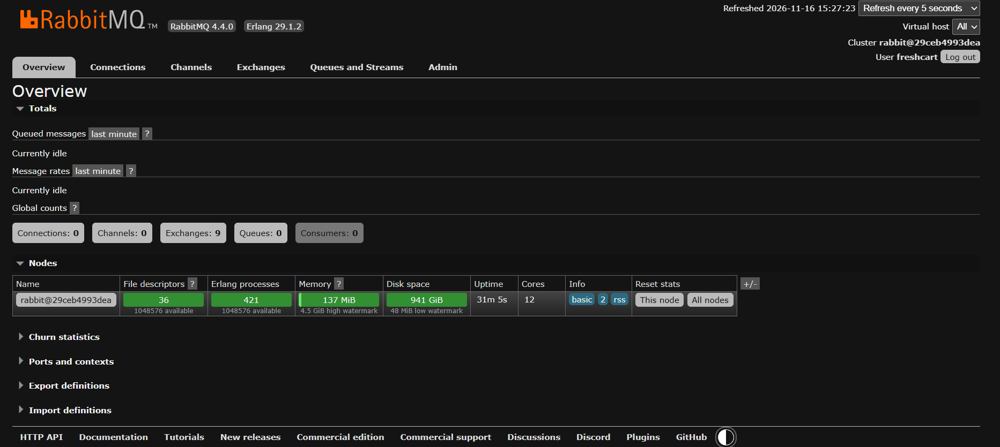

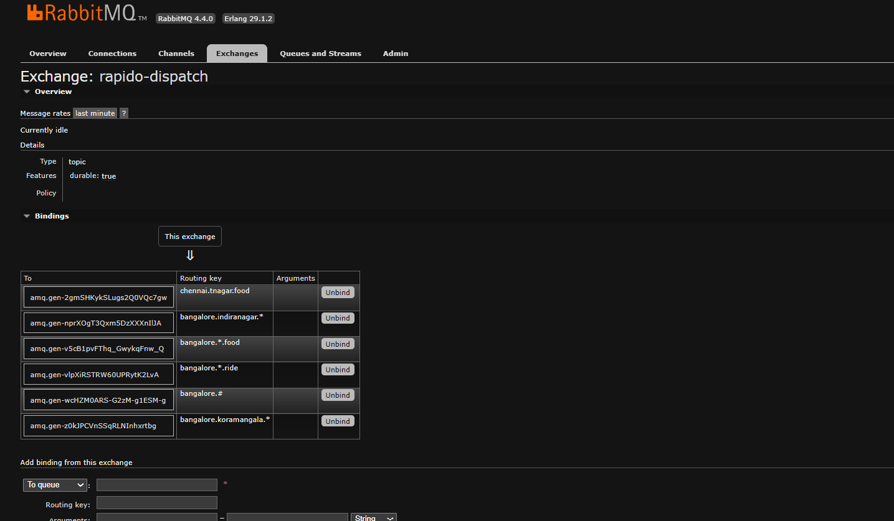

The C1 execution log is `c1_mage_run.log`; the three Mage images provide UI evidence complementary to that captured CLI output. The RabbitMQ overview is a broker status snapshot; the exchange page shows the six bindings. Screenshot content is evidence of the visible state at capture time, not an additional pipeline or routing experiment.

### Snowflake saved-record evidence

These four images are screenshots of previously saved report/log records. They are **not live Snowsight screenshots** and do not represent new database executions. B3's currency rule was already active during B1; its omitted-rule result is a SELECT-based counterfactual, not a historical before-and-after run.

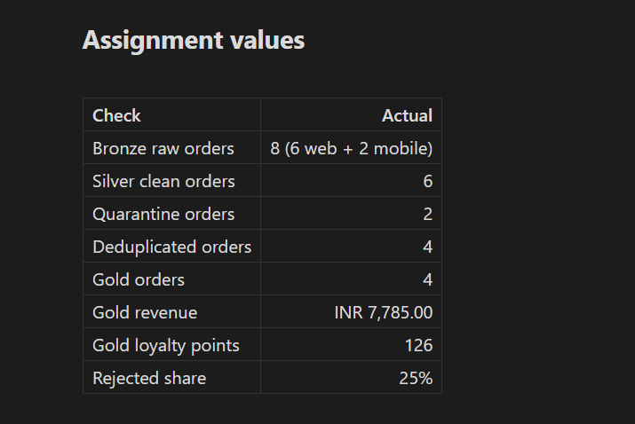

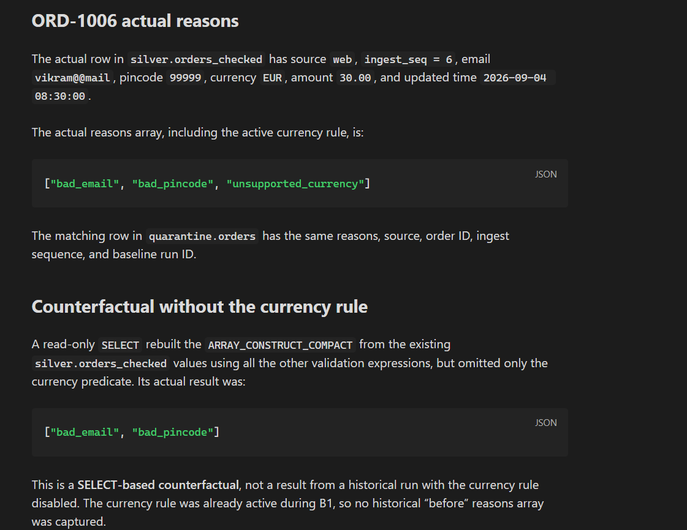

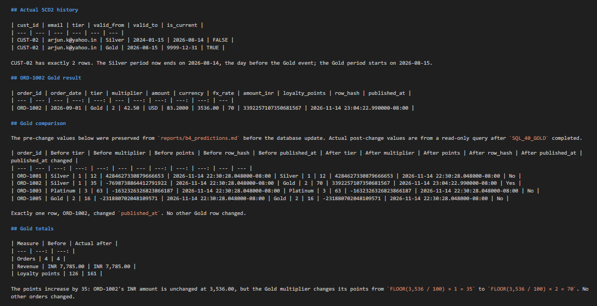

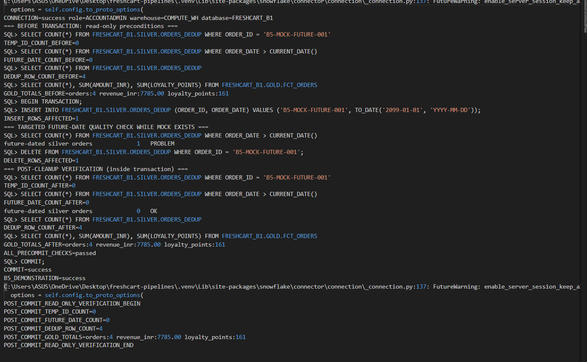
